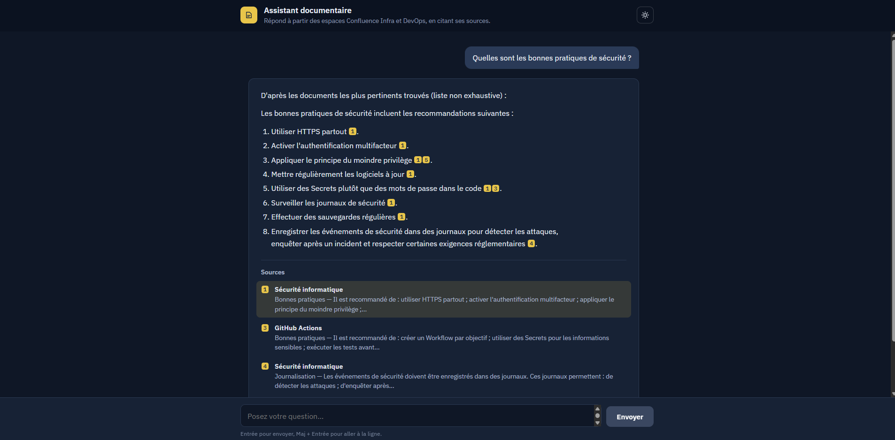
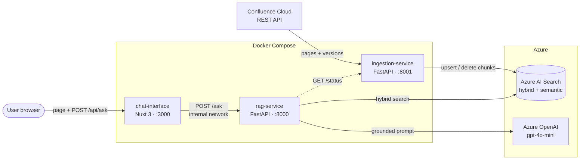

# RAG Confluence PoC

A retrieval-augmented assistant that answers questions about Confluence documentation in plain language, with citations to the source pages, built on Azure AI Search and Azure OpenAI.



## Overview

Technical and functional knowledge in a company is often scattered across Confluence spaces. Keyword search finds pages, not answers, and misses content written in other words than the question.

This assistant:

- answers questions in natural language, using **only** the indexed Confluence content;
- cites the pages each statement comes from (numbered markers such as `[1]`, `[2]`);
- **refuses** questions the documentation does not cover ("I can't find this information in the documentation"), without calling the LLM.

It is a Proof of Concept built during my summer 2026 internship at **Bacab Consulting**, as part of a two-person team. This repository covers the full PoC. My personal focus was the data side: the Confluence connector, incremental ingestion, indexing, the vector store benchmark and the Terraform foundations.

## Architecture



The backend is split into **two independent microservices**, each with its own code, dependencies, configuration and Docker image:

- `ingestion-service` is the only one that **writes** to the index;
- `rag-service` only **reads** from it.

The browser only talks to `chat-interface`. Its Nuxt server route (`/api/ask`) forwards each question to `rag-service` over the internal Docker network (backend-for-frontend pattern), so `rag-service` is never exposed to the browser and no CORS configuration is needed.

This keeps the batch workload (syncing Confluence) separate from the request path (answering users), so each service can be changed, restarted or scaled on its own. The two services share a contract: the same index, the same embedding model and the same index schema. `rag-service` checks that contract at startup through `GET /status`.

## Tech stack

| Area | Technology |
|---|---|
| Language / frameworks | Python 3.11, FastAPI, Pydantic · Nuxt 3 (Vue.js) for the chat UI |
| LLM | Azure OpenAI `gpt-4o-mini` (temperature 0) · Ollama (`llama3.2:3b`) as a local alternative |
| Embeddings | `all-MiniLM-L6-v2` (sentence-transformers, 384 dimensions, runs locally in the container) |
| Vector store | Azure AI Search (hybrid BM25 + vector search, semantic ranking) · ChromaDB as a local alternative |
| Source | Confluence Cloud REST API |
| Infrastructure as Code | Terraform (`azurerm`): resource group, AI Search, Azure OpenAI account and deployment |
| Containerisation | Docker, Docker Compose (healthchecks, ordered startup, persistent volume) |
| Testing | Pytest, FastAPI TestClient |

Backends are selected through environment variables (`DATA_SOURCE`, `VECTOR_STORE`, `SEARCH_MODE`, `LLM_SERVICE`), with no code change.

## Key features

- **Incremental sync.** Each page's Confluence version number is stored after a successful run. Only new or changed pages are reprocessed.
- **Stale chunk cleanup.** Every chunk carries a filterable `page_id`. Chunks from deleted pages are removed, and so are leftover chunks from shortened pages. A safeguard skips deletions if Confluence returns zero pages, so an outage cannot empty the index.
- **Relevance threshold.** Only passages with distance ≤ 2.0 (`distance = 4 − semantic reranker score`) are kept. If none qualifies, the service refuses **without calling the LLM**.
- **Source diversity.** Hybrid search retrieves 10 candidates; at most 3 chunks per page are kept, 5 in total. This stops one long page from crowding out the others, for example on comparison questions such as "Ansible vs Kubernetes".
- **Grounded answers with citations.** The prompt numbers each passage (`DOCUMENT 1..n`) and asks the model to cite them as `[n]`. The service maps the markers back to source pages and returns the source plus a 160-character excerpt, cleaned of Markdown formatting. Refusals return no citations. When an answer cites 3 or more different pages, it starts with a note that the list is not exhaustive.
- **Confluence format conversion.** Confluence storage format (XHTML + macros) is converted to Markdown, including code blocks. Chunks are split by heading, and code-only sections are merged with their explanation.
- **Chat interface.** Answers are rendered as Markdown (lists, code blocks; raw HTML escaped), citation markers become numbered badges linked to their source, and the UI has example questions, loading and error states, and a light/dark theme.
- **Documented API.** OpenAPI docs are available at `/docs` on both services.

## Design decisions

### LLM: from local Llama to Azure OpenAI

Development started with a fully local setup (Ollama with `llama3.2:3b`), so the pipeline could be built and tested without cloud access. The target architecture specifies Azure OpenAI hosted on Azure, so the project moved to `gpt-4o-mini`: low cost, sufficient quality for synthesising answers from retrieved passages, and consistent with the rest of the Azure stack. Temperature is set to 0 for stable answers. Ollama remains available through `LLM_SERVICE`.

### Vector store benchmark

Four options were compared with identical connectors (`add_chunks`, `search`, `is_empty`) on the same corpus: ChromaDB, pgvector, Qdrant and Azure AI Search.

| Criterion | ChromaDB | pgvector | Qdrant | Azure AI Search |
|---|---|---|---|---|
| Top-1 result (6 questions) | same | same | same | same |
| Avg search latency | 9.4 ms | 7.1 ms | 54.9 ms | 121.2 ms (remote) |
| Indexing 301 chunks | 0.34 s | 0.29 s | 0.20 s | 4.56 s (remote) |
| Hybrid + semantic ranking | no | to build | partial | built in |
| Fit with Azure target | rework needed | via Azure PostgreSQL | outside Azure | is the target |

Retrieval quality was identical. The latency gap mostly reflects that the local stores ran on the same machine, while every Azure call crosses the network. **Azure AI Search was chosen** because it is the target platform and provides hybrid search and semantic ranking natively; both features were tested and confirmed on the Free tier. pgvector is documented as the fallback if cost becomes a constraint.

The benchmark also showed that each store reports relevance differently:

- ChromaDB: squared Euclidean distance, which equals 2 × cosine distance for normalised vectors;
- pgvector and Qdrant: cosine distance;
- Azure AI Search: `1 / (1 + cosine distance)`.

Relevance thresholds therefore cannot be copied from one store to another.

## Results

All figures were measured on the PoC.

| Area | Result |
|---|---|
| Corpus | 2 Confluence spaces (Infra, DevOps), 16 test pages written with varied content and formats (hierarchy, code blocks, lists). Last full re-index: 256 chunks from 15 pages |
| Incremental sync | 5 scenarios validated end to end: full re-index, shortened page, deleted page (22 chunks removed), page with no indexable content, no-change run |
| Vector store benchmark (301 chunks, 6 questions) | Azure AI Search indexed in 4.6 s with 121 ms average search latency. Local stores answered in 7–55 ms. All four returned the same top-1 document on every question |
| Relevance threshold | 2.0, calibrated on 19 observed results: relevant passages 0.53–1.88, off-topic 2.16–2.40 |
| End-to-end response time (5 questions, local Docker calling Azure) | Median 2.8 s, mean 2.9 s, range 2.1–4.0 s. Search takes about 0.1 s; most of the time is LLM generation |
| Tests | 9 API tests with Pytest (4 ingestion, 5 RAG), all passing |
| Estimated production cost | About €68/month for ~3,000 questions (Azure pricing calculator: AI Search Basic + semantic ranking + `gpt-4o-mini`), excluding container hosting. The search service is most of it; the LLM costs about €1/month |

## Getting started

### Prerequisites

- Docker Desktop (with Docker Compose)
- Python 3.11+ (to run the tests outside Docker)
- Terraform and the Azure CLI (`az login`)
- An Azure subscription with access to Azure OpenAI
- A Confluence Cloud site, with an API token for the account that reads it

### 1. Clone

```bash
git clone https://github.com/wiam-fajraoui/rag-confluence-poc.git
cd rag-confluence-poc
```

### 2. Provision Azure resources (Terraform)

```bash
cd terraform
cp terraform.tfvars.example terraform.tfvars   # then fill in your own values
terraform init
terraform plan
terraform apply
```

Variables include `resource_group_name`, `location`, `search_service_name`, `search_sku`, `openai_account_name`, `openai_model_name`, `openai_model_version`, `openai_deployment_sku_name` and `openai_deployment_capacity`. Deployment types and quotas for `gpt-4o-mini` vary by region.

> `terraform plan` was validated during the internship. A full `terraform apply` run is part of the next steps, see below.

### 3. Configure environment variables

Each backend service reads its own `.env` file and receives only the secrets it needs:

```bash
cp ingestion-service/.env.example ingestion-service/.env
cp rag-service/.env.example rag-service/.env
```

Then fill in the values:

| Service | Variables to fill |
|---|---|
| `ingestion-service` | `CONFLUENCE_SITE_URL`, `CONFLUENCE_EMAIL`, `CONFLUENCE_API_TOKEN`, `CONFLUENCE_SPACE_KEYS`, `AZURE_SEARCH_ENDPOINT`, `AZURE_SEARCH_API_KEY` |
| `rag-service` | `AZURE_SEARCH_ENDPOINT`, `AZURE_SEARCH_API_KEY`, `AZURE_OPENAI_ENDPOINT`, `AZURE_OPENAI_API_KEY`, `AZURE_OPENAI_DEPLOYMENT_NAME` |

`DATA_SOURCE` and `VECTOR_STORE` must be identical in both files. Never commit `.env` files.

`chat-interface` needs no secret. Docker Compose sets `NUXT_RAG_API_URL=http://rag-service:8000` so its server can reach `rag-service`; when running the UI outside Docker (`npm install`, then `npm run dev`), it defaults to `http://127.0.0.1:8000`.

### 4. Run with Docker Compose

```bash
docker compose up -d --build
docker compose ps
docker compose logs -f ingestion-service
```

- Chat UI: http://localhost:3000
- RAG API docs: http://localhost:8000/docs (port published on `127.0.0.1` only, for local testing)
- Ingestion API docs: http://localhost:8001/docs

`rag-service` waits until `ingestion-service` is healthy. `/health` only responds after the initial sync. To trigger a sync manually:

```bash
curl -X POST http://localhost:8001/sync
```

To test the RAG API directly (the chat UI goes through its own server instead):

```bash
curl -X POST http://localhost:8000/ask \
  -H "Content-Type: application/json" \
  -d '{"question": "What is a Pod in Kubernetes?"}'
```

### 5. Run the tests

```bash
cd ingestion-service
pip install -r requirements.txt -r requirements-dev.txt
pytest

cd ../rag-service
pip install -r requirements.txt -r requirements-dev.txt
pytest
```

The tests use fake pipelines and need neither Confluence nor Azure.

## Project structure

```text
rag-confluence-poc/
├── ingestion-service/   # FastAPI service: Confluence sync, Markdown conversion, chunking, embeddings, indexing
├── rag-service/         # FastAPI service: hybrid search, relevance filter, prompt, LLM call, citations
├── chat-interface/      # Nuxt 3 chat UI showing answers and their sources
├── terraform/           # Azure infrastructure: resource group, AI Search, Azure OpenAI
└── docker-compose.yml   # Orchestration: healthchecks, startup order, volumes, internal network
```

The code is versioned on GitHub and mirrored to Azure Repos, which will host the Azure Pipelines workflow. Each milestone has a Git tag, from `v1-poc-local-stable` to `v9-suppressions`.

Both Python services follow the same layout:

| Folder | Role |
|---|---|
| `routes/` | HTTP endpoints |
| `schemas/` | Public API models |
| `services/` | Business logic |
| `connectors/` | Confluence, Azure AI Search, Azure OpenAI and the embedding model, swappable by environment variable |
| `models/` | Internal data structures |

## Limitations and next steps

- **Answer accuracy** has not yet been measured on a larger question set. The threshold was calibrated on a small sample, with a narrow margin on the relevant side.
- **CI/CD and cloud deployment** are not done yet. Next: an Azure Pipelines workflow (tests, image build and push, deployment to a VM with Docker Compose) and a full `terraform apply` run. The current setup runs locally against a development Azure subscription.
- **No API authentication.** This is acceptable for a local PoC, but must be added before any real deployment, for example with Microsoft Entra ID.
- **No conversation memory.** Follow-up questions are handled without the previous turns.
- **LLM output is not fully deterministic,** even at temperature 0.
- **Sync optimisations** have been designed but not yet integrated: listing page versions only and downloading changed pages, and polling the index instead of a fixed 5-second wait after writes.
- **Confluence conversion defect.** On one page (Kubernetes), two headings are lost during conversion and their text merges into the previous section. Source diversity works around it at query time; the converter still needs a fix.
- **Shared connector code is duplicated** across the two services. This is the trade-off of keeping them fully independent.

## Author

**Wiam Fajraoui** · Engineering student, Cloud specialisation
[LinkedIn](https://www.linkedin.com/in/wiamfajraoui)
